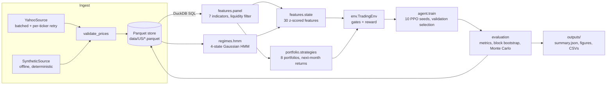

# regime-rl

**Regime-aware momentum strategy selection with a Gaussian HMM and a PPO agent.**

Each month, a reinforcement-learning agent chooses one of eight equity portfolios
(from a 3-stock momentum bet to 100% Treasuries) using a 38-feature view of the market,
including regime probabilities from a 4-state hidden Markov model. The goal is to beat
the index on an information-ratio basis, evaluated strictly out of sample.

This repository is the engineering version of my final-year project (TFG) in Economics
and Advanced Quantitative Methods at Universitat Pompeu Fabra (2025/26, tutor
Prof. Eulàlia Nualart). The original single-file research script is kept in
[`legacy/`](legacy/) for reference.

```
134 tests · 96% line coverage · ruff-clean · CI on Python 3.10 and 3.12
full pipeline runs offline on synthetic data in ~30 s
```

---

## Contents

- [Quick start](#quick-start)
- [Architecture](#architecture)
- [Data pipeline: Parquet + DuckDB](#data-pipeline-parquet--duckdb)
- [The model](#the-model)
- [Two fidelity modes](#two-fidelity-modes-tfg-and-corrected)
- [Testing](#testing)
- [Results](#results)
- [Design decisions](#design-decisions)
- [Limitations](#limitations)

## Quick start

```bash
git clone https://github.com/linx369/rl-trading-agent && cd rl-trading-agent
python -m venv .venv && source .venv/bin/activate
make install                 # pip install -e ".[dev]"

make test                    # unit + integration tests, no network needed
make smoke                   # whole pipeline on synthetic data (~30 s)

make ingest                  # download 20 years of S&P 500 prices into data/US/*.parquet
make run                     # corrected methodology (10 seeds; ~1-2 h on a laptop CPU)
make run-tfg                 # reproduce the thesis logic exactly
make compare                 # both runs side by side, straight from SQL
```

Everything is also available through the CLI:

```bash
regime-rl ingest  -c configs/us.yaml                  # incremental: only fetches what is missing
regime-rl run     -c configs/us.yaml --fidelity tfg --seeds 2025
regime-rl regimes -c configs/us.yaml                  # fitted HMM means, transitions, durations
regime-rl query   -c configs/us.yaml "SELECT ticker, count(*) FROM prices GROUP BY 1 LIMIT 5"
```

Other markets are one config away: `configs/eu.yaml` (EZU benchmark) and `configs/cn.yaml` (FXI).

## Architecture



```
src/regime_rl/
├── config.py            typed, validated YAML config (frozen dataclasses)
├── markets.py           US / EU / CN definitions: benchmark, macro ETFs, sector maps
├── data/
│   ├── sources.py       PriceSource protocol, YahooSource, SyntheticSource
│   ├── store.py         MarketStore: Parquet I/O, validation, DuckDB views
│   ├── ingest.py        incremental ingestion + ingest log
│   └── universe.py      S&P 500 constituents (yfinance → Wikipedia → GitHub fallback)
├── features/
│   ├── indicators.py    RSI, ATR, MACD, skip-1 momentum, 52-week high (vectorised)
│   ├── panel.py         daily → month-end panel, liquidity rank, beta, cross-section
│   └── state.py         macro + sector features, rolling normalisation
├── regimes/hmm.py       RegimeDetector: fit, filtered vs smoothed inference, profile
├── portfolio/           stock selection, weighting (max-Sharpe, momentum), the 8 actions
├── env/                 gates.py, reward.py (pure functions), trading_env.py (Gymnasium)
├── agent/train.py       PPO training, multi-seed selection, softmax ensemble
├── evaluation/          metrics, moving-block bootstrap, Monte Carlo
├── reporting/plots.py   the six thesis figures
├── pipeline.py          stage orchestration + persistence
└── cli.py               `regime-rl` entry point
```

## Data pipeline: Parquet + DuckDB

Prices are stored once, validated, and queried with SQL instead of being re-downloaded on
every run (the original script spent 10–20 minutes downloading each time).

| Table | Grain | Contents |
|---|---|---|
| `prices` | date × ticker | daily OHLCV + adjusted close for stocks |
| `etf_prices` | date × ticker | benchmark, TLT, HYG, IWM, QQQ, sector ETFs |
| `universe` | snapshot × ticker | constituent list and where it came from |
| `ingest_log` | ingestion run | rows fetched, rows rejected, source, window |
| `regimes_<mode>` | month | HMM probabilities |
| `state_<mode>` | month | the normalised observation the agent sees |
| `strategy_returns_<mode>` | month × action | next-month net return of each portfolio |
| `holdings_<mode>` | month × action × ticker | every portfolio's weights |
| `test_record_<mode>` | test month | chosen action, return, benchmark, regime signals |
| `runs` | run | metrics of every run, for comparison over time |

- **Incremental.** `ingest` asks the store for each ticker's last date and only downloads the gap.
- **Validated.** Rows with non-positive prices, `high < low` or negative volume are rejected and counted; duplicates on `(date, ticker)` resolve to the newest download.
- **Atomic writes.** Files are written to a temporary path and renamed, so a crash never leaves a half-written table.
- **SQL.** Every Parquet file is a DuckDB view; filters are pushed down into the files.

```sql
-- Which stocks did the Top-3 portfolio hold in early 2024?
SELECT date, ticker, round(weight, 3) AS w
FROM holdings_corrected WHERE action = 5 AND date BETWEEN '2024-01-01' AND '2024-04-30'
ORDER BY date, w DESC;

-- How did each strategy do in each regime? (training period)
SELECT CASE WHEN r.p_bear > 0.4 THEN 'bear-ish' ELSE 'other' END AS regime,
       avg(s."2") AS top30, avg(s."5") AS top3, avg(s."6") AS tlt
FROM strategy_returns_corrected s JOIN regimes_corrected r USING (date)
WHERE date < '2021-01-01' GROUP BY 1;
```

## The model

| Component | What it does |
|---|---|
| **Universe** | Current S&P 500 constituents; top 200 by 5-year average dollar volume; at least 12 months of history. |
| **Indicators** | Skip-1 momentum (12-1), 52-week-high proximity, momentum acceleration (3m − 6m), RSI(20), ATR(14), MACD(12/26), dollar volume. |
| **Regimes** | Gaussian HMM, 4 states, full covariance, on SPY daily log return, 20-day volatility, 63-day and 252-day returns. States named by mean daily return: bear < sideways < volatile < bull. |
| **State (38)** | 12 cross-sectional gauges, 4 regime probabilities (lagged one month), 14 macro/sector features, 8 recent strategy alphas. Rolling 36-month z-scores, clipped to ±3. |
| **Actions (8)** | Top 5 max-Sharpe, Top 15 max-Sharpe, Top 30 momentum, Mega-cap momentum, Sector-tilted, Top 3 ultra-concentrated, 100% TLT, Mean-reversion. |
| **Gates** | Concentrated portfolios blocked when P(bear) > 0.40 or P(volatile) > 0.50; Top 3 needs P(bull) ≥ 0.65; bonds blocked in a clear bull market. |
| **Reward** | 0.4 × rolling 6-month IR + 0.4 × Calmar signal − crash penalty + regime bonuses. |
| **Agent** | PPO (Stable-Baselines3), MLP 256-256-128, clip 0.15, entropy 0.06, 100 passes over the training months. |
| **Selection** | 10 seeds → keep ≥ median validation alpha → top 3 → softmax (T = 0.5) ensemble vs best single seed, decided on validation only. |
| **Split** | Train 2006–2020, validation 2021–2022, test 2023–2026, chronological. |
| **Robustness** | Cross-seed test distribution, 6-month moving-block bootstrap (2,000 reps), 2-year Monte Carlo (1,000 paths). |

## Two fidelity modes: `tfg` and `corrected`

Refactoring the original script surfaced several defects: most importantly, **look-ahead
in the HMM** (smoothed probabilities from a model fitted on the full sample) and a **momentum
signal computed with daily window lengths on monthly prices**. A single EM run could also leave a regime almost empty, so corrected mode keeps the best of ten EM restarts. Fixing them silently would
make the published thesis numbers impossible to reproduce, so both versions coexist:

```bash
regime-rl run -c configs/us.yaml --fidelity tfg        # the thesis, warts and all
regime-rl run -c configs/us.yaml --fidelity corrected  # the fixed methodology
```

All thirteen differences, their expected effect and the tests that pin them are listed in
[`docs/corrections.md`](docs/corrections.md).

## Testing

```bash
make test       # 131 fast tests, ~45 s
make test-all   # + PPO end-to-end runs and coverage report
```

The tests concentrate on the properties that make a backtest trustworthy:

- **No look-ahead**: filtered HMM probabilities for past days are unchanged when future
  data is appended (and smoothed ones are shown to change); rolling z-scores and momentum
  rankings ignore shocks to later prices.
- **Date alignment**: an action's return at date *d* equals its holdings' realised return
  in month *d + 1*, net of costs; the bond action equals TLT's next-month return.
- **Chronological, disjoint splits.**
- **Exact formulas**: indicators against hand-computed values, the reward against a worked
  example, metrics against closed forms, bootstrap draws against the original global-RNG code.
- **Data integrity**: validation rules, upsert semantics, incremental ingestion producing the
  same table as a single full download, retry behaviour of the Yahoo adapter.
- **Environment contract**: Gymnasium's `check_env`, observation bounds, gate fallbacks.
- **Both fidelity modes** wherever their behaviour differs.

CI runs lint, the full test suite on Python 3.10 and 3.12, and a synthetic end-to-end run.

## Results

Out-of-sample results reported in the thesis (`tfg` logic, seed 2025, Jan 2023 – Mar 2026):

| | Agent | SPY |
|---|---|---|
| Annual return | 25.02% | 17.56% |
| Annual volatility | 20.09% | 11.99% |
| Sharpe ratio | 1.25 | 1.46 |
| Information ratio | 0.51 | – |
| Max drawdown | −21.58% | −8.33% |
| Alpha (annual, vs SPY) | +7.47% | – |
| 90% bootstrap CI for alpha | [−10.33%, +35.08%] | – |

The agent earned more than the index but with more risk: its Sharpe and Calmar ratios were
lower, and the bootstrap interval for alpha includes zero, so the outperformance is not
statistically significant over 39 months.

> **Corrected-mode results on real data:** _to be added after running `make ingest run`._
> Because the corrected mode removes look-ahead from the regime model, expect weaker numbers.

Each run writes `outputs/<market>_<mode>/` containing `summary.json`, `bootstrap_ci.csv`,
`cross_seed_test_metrics.csv`, `seed_selection.csv`, `test_record.csv`, `hmm_profile.md`
and six figures, and appends a row to the `runs` table.

## Design decisions

- **Pre-computed action returns.** Every portfolio's next-month return is computed once per
  month before training, so the environment is a table lookup: training is fast, and the
  agent physically cannot see a price after its decision date.
- **Pure functions at the core.** Gates, reward terms, indicators and metrics take plain
  values and return plain values, so they are tested in isolation without building an environment.
- **Injected data sources.** `PriceSource` is a protocol; the Yahoo adapter takes an injectable
  downloader, and a deterministic synthetic market lets the whole pipeline run in CI with no network.
- **One switch for methodology changes.** Every difference between the thesis and the corrected
  code is behind `cfg.tfg`, so the two can be compared on identical data.
- **Reproducibility.** Frozen, validated configs; fixed data windows; seeded HMM, PPO,
  bootstrap and Monte Carlo (using `RandomState` so the original script's draws are reproduced);
  the full config is saved in every `summary.json`.

## Limitations

- **Survivorship bias.** The universe is today's S&P 500, so companies that failed or left the
  index are missing and historical returns are overstated by an unknown amount.
- **Short, favourable test window.** 2023–2026 was a momentum-friendly, AI-led bull market.
- **Seed sensitivity.** PPO results vary widely across seeds; the cross-seed table shows the spread.
- **Costs.** A flat 20 bp per month is an institutional-level cost and ignores turnover.
- **Not investment advice.** This is a research project.

## Citation

Owen Prats, T. (2026). *Adaptive Algorithmic Trading with Reinforcement Learning and Bayesian
Regime Detection*. Final-year project, Universitat Pompeu Fabra.

Key references: Jegadeesh & Titman (1993); George & Hwang (2004); Daniel & Moskowitz (2016);
Hamilton (1989); Schulman et al. (2017).
